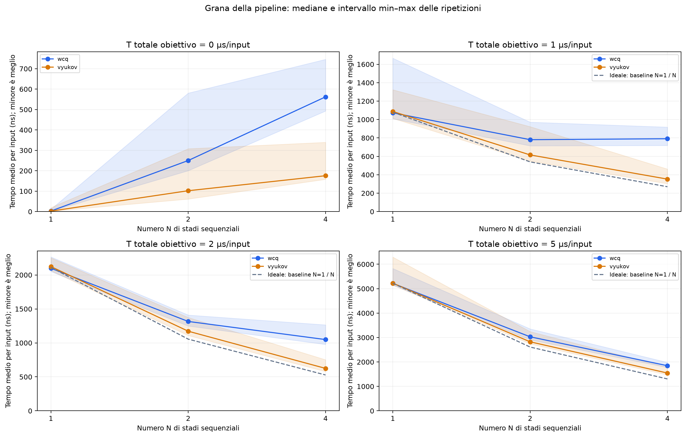
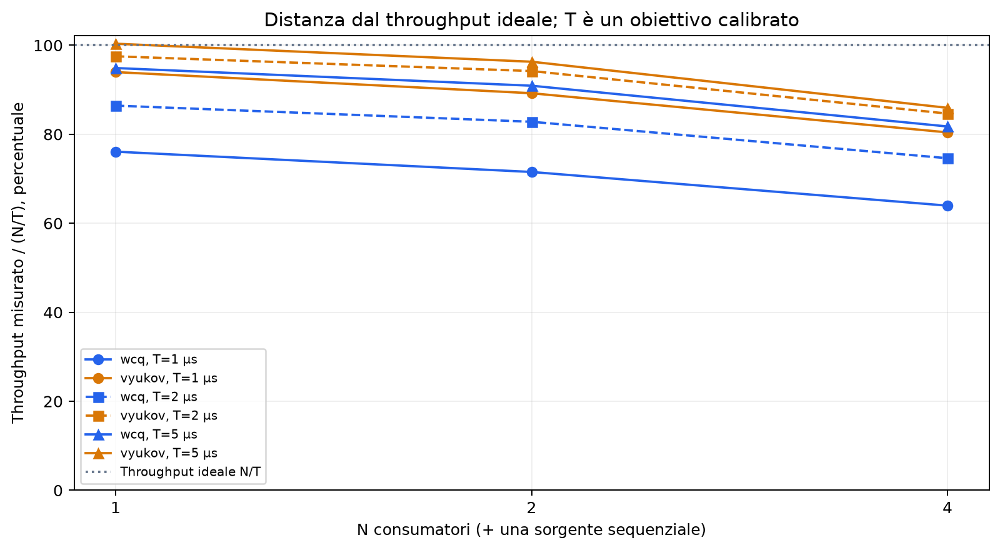
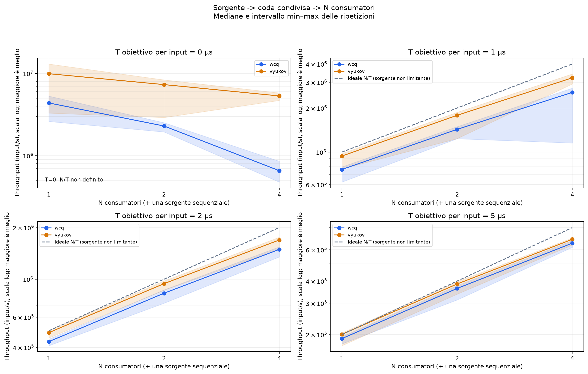
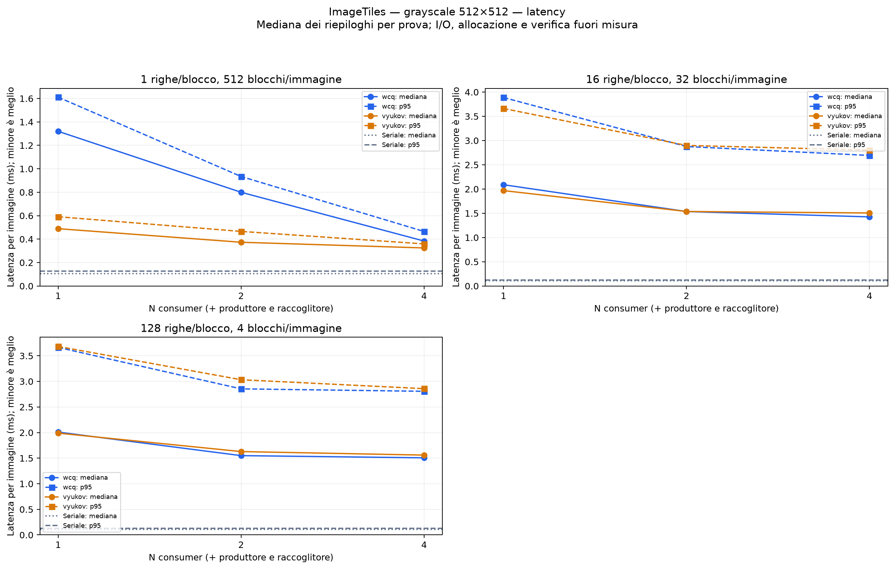
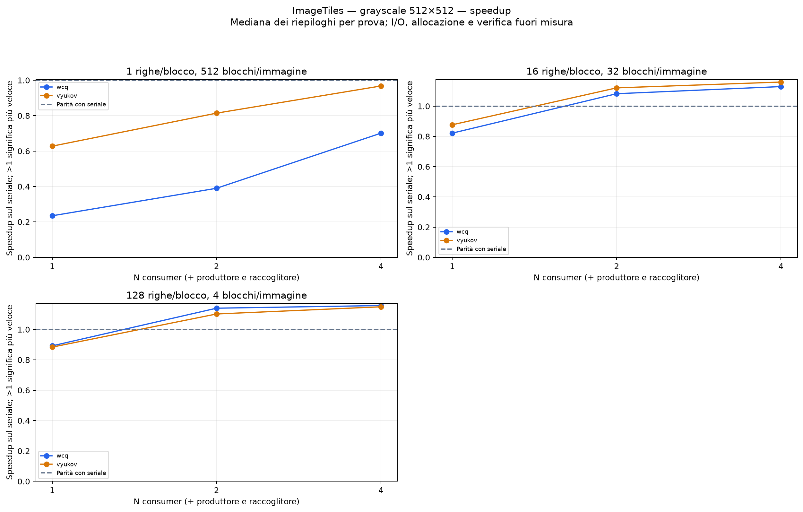
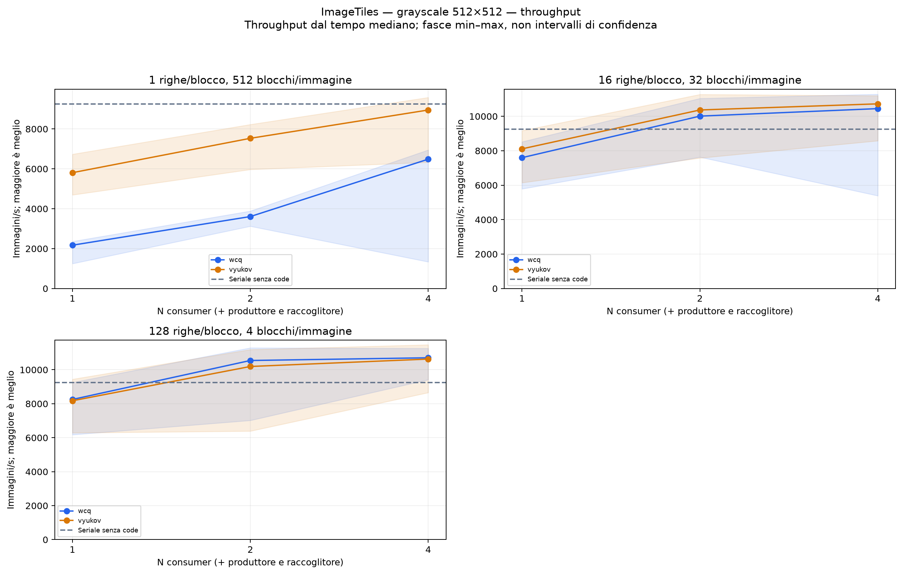

# Confronto wCQ–Vyukov: tre benchmark

Campagna completata: **3,350 misure**, 50 ripetizioni per configurazione.
CPU: Intel(R) Core(TM) i7-10750H CPU @ 2.60GHz. Core fisici usati: [0, 1, 2, 3, 4, 5].
Compilatore: Mojo 1.1.0 (8189361e); ottimizzazione -O3, nessun sanitizer.
N misurati: [1, 2, 4]. N della griglia canonica non misurati: [8, 16].

Capacità utile 1024 per entrambe le code. Sintetici: 50.000 input, T=0,1,2,5 µs. Immagini: 32 frame RGB 512×512, strisce 1/16/128 righe e baseline seriale.

## Come leggere il confronto

**Rapporto W/V > 1 favorisce wCQ; < 1 favorisce Vyukov.** Il rapporto usa throughput ricavati dai tempi mediani. N=1 della pipeline non usa code e non assegna un vincitore.

Si confrontano implementazioni concrete: wCQ usa due ring di indici e primitive atomiche C sequenzialmente consistenti; Vyukov usa atomiche Mojo relaxed/acquire/release e payload separato. Sono inclusi costo delle chiamate C, rappresentazione dei dati e diagnostica già interna al porting. I risultati non isolano il costo teorico del solo algoritmo e non certificano wait-freedom.

I carichi e la topologia sono quelli del confronto Rigtorp, ma tutti i tempi sono nuovi: i risultati storici non vengono uniti a questi campioni.

## PipelineGrain e FarmThroughput

Throughput in input/s. Intervalli percentile bootstrap al 95% individuali, 20.000 ricampionamenti: indipendenti nella pipeline e appaiati per repeat nella farm. Non corretti per confronti multipli; analisi esplorativa di una sola sessione. Il dettaglio della soglia pratica del 5% è nei singoli `confronto_50.md`.

| Benchmark | N | T µs | wCQ input/s | Vyukov input/s | W/V | IC 95% |
| --- | ---: | ---: | ---: | ---: | ---: | --- |
| PipelineGrain | 1 | 0 | 352,416,698 | 421,887,525 | baseline senza code | — |
| PipelineGrain | 1 | 1 | 932,144 | 919,778 | baseline senza code | — |
| PipelineGrain | 1 | 2 | 476,581 | 470,991 | baseline senza code | — |
| PipelineGrain | 1 | 5 | 191,623 | 191,364 | baseline senza code | — |
| PipelineGrain | 2 | 0 | 3,996,402 | 9,780,512 | 0.409 | 0.379–0.444 |
| PipelineGrain | 2 | 1 | 1,280,178 | 1,624,395 | 0.788 | 0.766–0.811 |
| PipelineGrain | 2 | 2 | 760,104 | 853,228 | 0.891 | 0.868–0.910 |
| PipelineGrain | 2 | 5 | 329,989 | 353,894 | 0.932 | 0.923–0.943 |
| PipelineGrain | 4 | 0 | 1,779,066 | 5,689,141 | 0.313 | 0.303–0.334 |
| PipelineGrain | 4 | 1 | 1,263,526 | 2,834,034 | 0.446 | 0.432–0.461 |
| PipelineGrain | 4 | 2 | 953,327 | 1,600,538 | 0.596 | 0.585–0.618 |
| PipelineGrain | 4 | 5 | 541,505 | 646,578 | 0.837 | 0.825–0.849 |
| FarmThroughput | 1 | 0 | 4,378,318 | 9,938,923 | 0.441 | 0.413–0.471 |
| FarmThroughput | 1 | 1 | 760,913 | 939,735 | 0.810 | 0.798–0.824 |
| FarmThroughput | 1 | 2 | 432,191 | 487,605 | 0.886 | 0.873–0.892 |
| FarmThroughput | 1 | 5 | 189,765 | 200,693 | 0.946 | 0.941–0.953 |
| FarmThroughput | 2 | 0 | 2,294,395 | 7,321,257 | 0.313 | 0.296–0.328 |
| FarmThroughput | 2 | 1 | 1,430,603 | 1,784,448 | 0.802 | 0.787–0.820 |
| FarmThroughput | 2 | 2 | 828,121 | 942,065 | 0.879 | 0.865–0.888 |
| FarmThroughput | 2 | 5 | 363,634 | 385,200 | 0.944 | 0.923–0.951 |
| FarmThroughput | 4 | 0 | 656,298 | 5,327,211 | 0.123 | 0.118–0.127 |
| FarmThroughput | 4 | 1 | 2,558,573 | 3,216,874 | 0.795 | 0.780–0.813 |
| FarmThroughput | 4 | 2 | 1,492,344 | 1,692,973 | 0.881 | 0.872–0.891 |
| FarmThroughput | 4 | 5 | 654,000 | 687,511 | 0.951 | 0.942–0.961 |

## ImageTiles

Throughput in immagini/s; p95 in millisecondi, riepilogato come mediana dei p95 delle singole prove. Questi rapporti sono descrittivi: non sono corredati da intervalli di confidenza.

| Righe/blocco | N | wCQ img/s | Vyukov img/s | W/V | p95 wCQ ms | p95 Vyukov ms |
| ---: | ---: | ---: | ---: | ---: | ---: | ---: |
| 1 | 1 | 2,171.9 | 5,807.7 | 0.374 | 1.611 | 0.591 |
| 1 | 2 | 3,608.0 | 7,531.5 | 0.479 | 0.934 | 0.466 |
| 1 | 4 | 6,484.5 | 8,950.3 | 0.725 | 0.465 | 0.359 |
| 16 | 1 | 7,599.2 | 8,110.7 | 0.937 | 3.888 | 3.661 |
| 16 | 2 | 10,012.0 | 10,369.1 | 0.966 | 2.877 | 2.899 |
| 16 | 4 | 10,447.9 | 10,725.4 | 0.974 | 2.693 | 2.804 |
| 128 | 1 | 8,252.0 | 8,175.6 | 1.009 | 3.664 | 3.683 |
| 128 | 2 | 10,545.3 | 10,193.0 | 1.035 | 2.854 | 3.032 |
| 128 | 4 | 10,705.4 | 10,629.7 | 1.007 | 2.806 | 2.858 |

Baseline seriale senza code: **9,250.0 immagini/s**.

La latenza parallela va da prima del primo enqueue di una immagine al suo ultimo completamento. Non include l’attesa prima di quella emissione. Il seriale misura il tempo di servizio del kernel per immagine: non simula la stessa coda di arrivi esterni. Leggere latenza e throughput insieme.

## Correttezza e verifiche

Tutte le ripetizioni sono presenti una sola volta; i conteggi e gli hash dei sorgenti sono stati ricontrollati dal generatore del rapporto. La farm verifica ogni ID e il relativo calcolo, ImageTiles verifica copertura dei blocchi e ogni byte rispetto a un oracolo scalare. La pipeline verifica un digest sensibile all’ordine contro il calcolo seriale; quest’ultimo resta un controllo probabilistico.

Il pinning e le allocazioni precedono il timer. I tempi includono riempimento, svuotamento, attesa e completamento dei task; non sono la latenza di una singola operazione di coda. I risultati non dimostrano superiorità universale o stabilità fra giorni e macchine.

## Grafici

