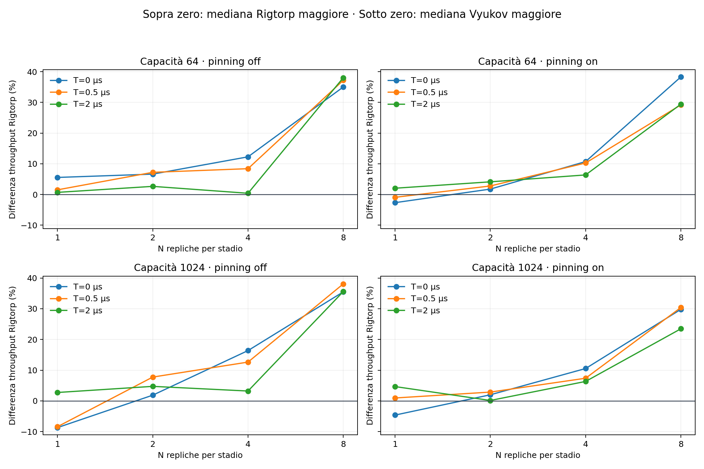

# Farm MPMC in MoStream — risultati del 26 ottobre 2026

Il nuovo benchmark usa Source → N Compute A → N Compute B → Sink. La coda centrale ha N produttori e N consumatori; i task totali sono 2N+2. I messaggi hanno ID Int e valore UInt64. Il lavoro totale per input è fisso e distribuito a metà fra A e B. Tutte le code fra stadi usano lo stesso backend selezionato, quindi si misura la pipeline completa, non la sola coda centrale.

La farm originale è conservata. La nuova variante è `farm_mpmc.mojo`, eseguita dal runner `run_mpmc.py`.

## Esplorazione

672 esecuzioni misurate: N=1,2,4,8 per stadio; T=0,0.5,2 µs totali per input; capacità 64/1024; pinning off/on; sette ripetizioni per backend in ognuna delle 48 configurazioni. Ogni esecuzione ha verificato esattamente unicità e valore dei risultati. Nessun caso è stato omesso.

Rigtorp ha una mediana maggiore in 43 configurazioni su 48, con vantaggi più marcati a N=8. Il massimo esplorativo è +38,3%, a N=8, T=0, capacità 64 e pinning on. Questo massimo è stato selezionato dopo aver osservato lo sweep e non va usato da solo come stima di un vantaggio stabile.

## Conferma separata

È stato ripetuto il caso N=8, T=0, capacità 64, sia off sia on, con 30 nuove coppie per modalità (120 nuove esecuzioni, non riutilizzate dallo sweep).

| Pinning | Vyukov, mediana input/s | Rigtorp, mediana input/s | Differenza delle mediane | Coppie vinte da Rigtorp |
|---|---:|---:|---:|---:|
| off | 868,842 | 1,176,831 | +35.4% | 30/30 |
| on | 831,498 | 1,082,217 | +30.2% | 30/30 |

Il vantaggio si ripresenta in tutte le coppie della conferma. Questo supporta un vantaggio ripetibile di questa implementazione Rigtorp su questa macchina e in questa topologia contesa; non dimostra superiorità generale né identifica da solo la causa algoritmica. Il T=0 elimina il calcolo del kernel, ma restano gestione dei messaggi, chiamate, source, sink, runtime e verifica dei contatori nel sink.

## Effetto del pinning

Nella conferma il pinning riduce il throughput mediano assoluto di Vyukov da circa 869 mila a 831 mila input/s e quello di Rigtorp da circa 1,177 milioni a 1,082 milioni. Quindi il vantaggio Rigtorp non nasce da un miglioramento dovuto al pinning. I task sono fissati a CPU logiche su core fisici distinti; la lista CPU e l’ambiente sono registrati nei metadati. L’assegnazione può attraversare socket: non è stata ottimizzata la collocazione NUMA.

## Metodo e limiti

Mojo 1.1.0; 50.000 input per esecuzione. Si misura Pipeline.run, compresi setup, eventuale pinning, stampe, task, EOS e teardown; costruzione della Pipeline, avvio del processo e oracolo finale sono esclusi. Il throughput è M * 1e9 / elapsed_ns e non misura la latenza individuale. Ordine delle configurazioni e dei backend mescolato con seed registrato, stessa calibrazione e stesso numero di iterazioni fra backend. Processi nuovi per ogni campione.

Il confronto con la vecchia farm non può isolare una singola causa: cambiano numero di stadi, topologia e numero di input. La crescita del vantaggio a N=8 è coerente con un effetto della contesa, ma per attribuirlo specificamente a fetch-add/CAS occorrerebbero misure interne aggiuntive. Cinque configurazioni dello sweep favoriscono Vyukov: sono conservate e mostrate nei grafici.

Fonti: `raw.csv`, `summary.csv`, `metadata.json`, `campaign.log`; verifica indipendente in `conferma/`. Grafico completo del throughput: `mpmc_throughput.png` (anche PDF e SVG). Metodo e comandi: `../../README_MPMC.md`.
